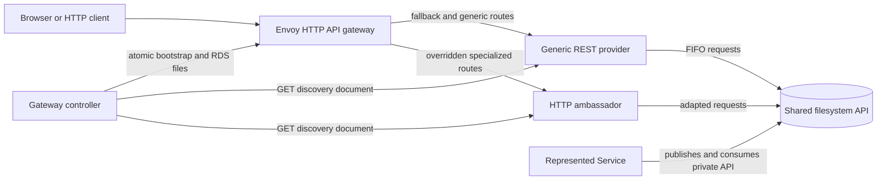

# REST API customization: implementation v1

## Status and scope

This record describes the currently implemented HTTP customization architecture
for filesystem APIs. The implementation is a dynamic API gateway with ordered
route providers and optional BFF-like ambassadors. Repository documentation
uses the term **pseudo-BFF** for this combination; it is not a claim that the
gateway itself is a conventional Backend for Frontend.

The implementation covered here consists of:

- the generic `http_api_gateway` Envoy data plane and discovery controller;
- the generic `rest_api` filesystem-to-HTTP provider;
- an HTTP ambassador;
- the Represented Service behind that ambassador;
- the discovery document and ordered route-ownership rules; and
- a concrete AI-agent implementation example and its HTTP streaming Compose
  deployment.

The generic terms used throughout this record are:

- **HTTP ambassador**: an HTTP provider that supplies frontend presentation,
  validation, aggregation, or protocol adaptation for another service.
- **Represented Service**: the service whose operations or private protocol are
  exposed or adapted by an HTTP ambassador. The Represented Service remains the
  owner of its business behavior and does not need to implement the HTTP UI.

## Context

The original HTTP dispatcher configuration contained
represented-service-specific route regular expressions and a service-specific
Envoy cluster. That coupled a generic proxy image to one application and
required editing static Envoy YAML whenever a backend added or replaced a
query.

The current design moves route ownership to the HTTP providers. Each provider
describes its public action paths through a versioned discovery endpoint. A
controller validates and merges those descriptions, then publishes Envoy
configuration dynamically. Envoy retains no represented-service-specific
paths, names, or HTML asset locations.

## Architectural decision

1. Envoy is a generic HTTP gateway and does not contain service-specific route
   expressions or public service names in a checked-in configuration file.
2. Providers publish route documents at
   `GET /.well-known/http-api-routes/v1`.
3. `BACKENDS_FOR_FRONTENDS` supplies an ordered, comma-separated list of HTTP
   provider origins. The name is retained for future frontend-oriented
   extensions even though the current controller is an API-gateway controller.
4. Providers are merged from left to right. A later provider owns any path also
   advertised by an earlier provider.
5. The first provider is the catch-all destination for paths that no provider
   advertises.
6. Provider topology is bootstrap configuration. Changing the provider list,
   order, hostname, or port requires recreating the controller and gateway.
   Route-document changes within the same topology are applied at runtime
   through filesystem RDS without restarting Envoy.
7. A specialized HTTP ambassador owns frontend presentation and protocol
   adaptation. Its private implementation paths and Envoy cluster identifiers
   are not part of the public API.

## Component model

| Component | Responsibility |
| --- | --- |
| Generic REST provider | Restores the shared filesystem API, serves generic pages and actions, and derives discovery routes from restored JSON schemas. |
| HTTP ambassador | Serves a frontend-oriented HTTP experience, validates HTTP input, and adapts requests to the Represented Service's API or private protocol. |
| HTTP API gateway controller | Polls providers, validates discovery documents, resolves ownership, and atomically publishes Envoy bootstrap and RDS resources. |
| HTTP API gateway | Runs Envoy with generated private clusters and watches the controller's RDS file for route updates. |
| Represented Service | Owns the business operations exposed through the ambassador; it does not need to implement the HTTP presentation layer. |
| Shared `/api` volume | Carries filesystem API schemas, request FIFOs, session results, and ambassador staging data. |



## Discovery contract

Every provider returns `application/json` with this version-1 shape:

```json
{
  "schema_version": 1,
  "revision": "sha256:<digest>",
  "routes": [
    {
      "path": "/api.pmccabe_collector.restapi.org/example/v1",
      "timeout_seconds": 60
    }
  ]
}
```

The route list is sorted and its revision is deterministic. Paths must be
canonical non-root absolute paths. Queries, fragments, repeated slashes,
backslashes, dot segments, control characters, duplicate paths, and the
discovery endpoint itself are rejected. Timeouts must be positive and no
greater than 3600 seconds.

Discovery version 1 assigns a complete path to one provider. It does not split
ownership by HTTP method. A provider therefore advertises an action path once
even when `GET` renders a page and `POST` or `PUT` performs the action.

The discovery endpoint is controller-facing metadata, not a merged public
catalog served by Envoy. The controller's normalized merged catalog is written
to its private `merged_routes.json` state file.

## Ordered route ownership

Provider order has deliberate semantics:

| Route class | Owner |
| --- | --- |
| Paths advertised by only one provider | That provider |
| Paths advertised by more than one provider | The last provider in `BACKENDS_FOR_FRONTENDS` |
| Paths advertised by no provider | The first provider, as the catch-all |

The controller assigns private cluster names such as `backend_0` and
`backend_1`. Public configuration does not depend on Represented Service
names, and consumers never see those cluster identifiers.

For every advertised path, RDS contains an exact match and a match that accepts
the trailing-slash form. Query strings are preserved by Envoy. All HTTP methods
for that path go to the same owning provider, which remains responsible for
returning `405 Method Not Allowed` where appropriate.

### Example: AI-agent HTTP ambassador

The current Agentic RAG HTTP deployment configures:

```text
BACKENDS_FOR_FRONTENDS=http://rest-api:5000,http://ai-agent-http-ambassador:8081
```

In this example, `rest-api` owns its unique routes and is the catch-all. The
AI-agent HTTP ambassador owns the overlapping chat and `rag_add` paths because
its concrete service, `ai-agent-http-ambassador`, appears later. The old
`ai_agent_http` Envoy cluster name is not exposed.

## Controller lifecycle and dynamic Envoy configuration

At startup the controller:

1. parses and validates `BACKENDS_FOR_FRONTENDS`;
2. creates one private strict-DNS Envoy cluster per provider;
3. requests a valid initial discovery document from every provider;
4. merges route ownership in configured order;
5. writes `bootstrap.json`, `rds.json`, and `merged_routes.json` under
   `/var/lib/http-api-gateway`; and
6. creates `ready` only after the initial complete configuration exists.

Envoy starts after the controller health check observes `ready`. It reads the
generated bootstrap and watches `rds.json`. The controller replaces RDS
atomically, so readers never observe a partially written route table.

After startup the controller continues polling. A new or removed route causes
RDS regeneration only when normalized ownership changes. A provider revision
change by itself is not a routing signal. After a provider has supplied one
valid document, transient discovery failures retain that provider's last known
good snapshot. Startup remains unavailable until every configured provider has
supplied an initial valid document.

## Provider responsibilities

### Generic REST provider

`rest_api` restores schemas and `index.md` from the live filesystem API. Its
generated Flask application exposes generic query processors and builds its
discovery response from the same restored schemas. The filesystem API remains
the source of truth; route strings are not maintained in separate Envoy
configuration.

As the first provider, `rest_api` also renders the main menu and receives
unadvertised fallback traffic. It must remain generic and must not know which
specialized ambassadors may replace individual routes.

### HTTP ambassador

An HTTP ambassador derives its public action paths from the Represented
Service's authoritative schemas or equivalent contract. It owns the
frontend-facing presentation and request adaptation while leaving business
operations in the Represented Service. Its private UI paths, internal
connection details, and generated Envoy cluster name are not public API.

### Example: AI-agent HTTP ambassador

This concrete HTTP ambassador image copies exactly `chat.json` and
`rag_add.json` from the AI-agent Represented Service. At startup it reads every
JSON file in its configured schema directory, rejects query paths the server
does not support, and advertises the two supported action paths.
It provides:

- a chat page and JSON `POST` adapter;
- a UTF-8 document-selection page and binary `PUT` adapter;
- prompt, media-type, size, Unicode, FIFO, result, and timeout validation; and
- bounded session-aware translation to the existing filesystem API.

The UI has no public `/ai-agent-ui` prefix. CSS and JavaScript are embedded
with per-response CSP nonces, so asset placement remains private to the
ambassador. Chat history is browser-tab state, not server-side agent memory.
The user can choose whether prior successful turns are included in the next
`user_prompt`.

Uploads are staged below `/api/.http_ambassador/staging`, outside the generic
filesystem API domain. Completed operations remove their staging directory.
Files are retained when completion is unknown so a queued agent operation is
not deprived of its input.

## Failure and readiness behavior

- Invalid provider topology or discovery data prevents initial readiness.
- A provider that has never returned valid discovery blocks controller
  readiness; a later polling failure uses its last known good snapshot.
- Envoy starts only after the controller has generated a complete bootstrap and
  initial RDS resource.
- HTTP ambassador pages may render before the Represented Service is ready,
  while action requests return `503` when required dependencies are
  unavailable.
- Invalid downstream JSON returns `502`; an uncertain FIFO deadline returns
  `504` with `completion_unknown: true`; client validation uses `400`,
  `413`, or `415` as appropriate.
- The gateway does not retry application operations whose completion is
  unknown.

An HTTP ambassador's health contract must state which downstream dependencies
it checks. End-to-end tests must distinguish container startup, gateway
discovery readiness, Represented Service readiness, and successful operations.

## Example deployment: AI-agent HTTP ambassador

In this implementation example, the ambassador health endpoint checks FIFO
presence, not model, vector-store, or document-database readiness.
`ai_agents_framework/compose.rag-agent.http.streaming.yaml` combines the RAG
agent as the Represented Service, vector database, document dispatcher, generic
REST provider, HTTP ambassador, gateway controller, and Envoy. All join
`api.pmccabe_collector.network`. Filesystem API participants share the
external `api.pmccabe_collector.restapi.org` volume, while controller and
Envoy share a private gateway-configuration volume.

The streaming deployment sends container logs to the separately managed logger
subsystem. The on-demand test-aggregator subsystem attaches to the logger's
Envoy admin tap, publishes decoded events through Kafka, and treats the
`log_event_aggregator` exit status as the authoritative capture-analysis
result.

## Verification strategy

Focused tests cover three boundaries:

1. gateway controller tests validate provider parsing, discovery validation,
   left-to-right replacement, fallback routing, and RDS generation;
2. REST and HTTP ambassador tests validate deterministic discovery and their
   own request adaptations; and
3. in the AI-agent HTTP ambassador example, the Agentic RAG HTTP streaming
   workflow builds every participating image before launch, verifies generic
   and specialized gateway pages, executes the
   black-box filesystem API tests, finishes capture, and waits for the
   streaming aggregator result before cleanup.

The dedicated HTTP test overlay mounts the same external filesystem API volume
as the HTTP deployment. Reusing the non-HTTP streaming overlay would mount a
different project volume and could test a filesystem API that the HTTP services
do not use.

## Known constraints

- Changing provider topology requires container recreation; only route contents
  are dynamic through RDS.
- Discovery version 1 cannot route different HTTP methods for one path to
  different providers.
- The first provider is both a normal route provider and the catch-all, so its
  availability remains required for initial startup.
- Last-known-good discovery improves availability but can temporarily preserve
  a route that a failing provider intended to remove.
- In the AI-agent HTTP ambassador example, browser chat history is serialized
  into one filesystem API `user_prompt`; it is not structured or persistent
  model memory.
- Filesystem FIFOs require a shared local-volume implementation. A remote
  gateway needs only HTTP reachability, but the HTTP ambassador and its
  Represented Service must share compatible filesystem semantics.

## Adding another HTTP ambassador or specialized provider

1. Derive its public paths from an authoritative schema or equivalent source.
2. Implement the versioned discovery document and a separate health endpoint.
3. Keep presentation and private assets inside the provider rather than adding
   service-specific Envoy configuration.
4. Add the provider origin to `BACKENDS_FOR_FRONTENDS` at the precedence
   position that expresses the desired collision winner.
5. Recreate the controller and gateway for the topology change.
6. Add deterministic discovery, request-adaptation, collision, and real Envoy
   forwarding tests.
