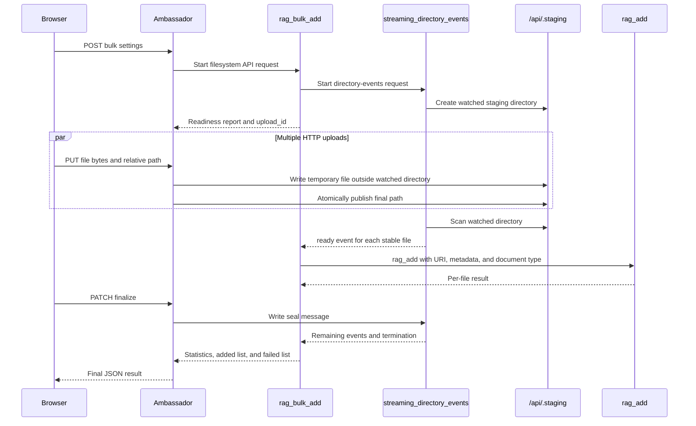

# Example: AI-agent HTTP ambassador

This service is a concrete implementation of the generic **HTTP ambassador**
pattern. The AI agent is the **Represented Service**. The ambassador serves
schema-driven chat, single-document, and bulk file/folder pages. It forwards
requests to the existing filesystem API with the shared `APIQueryInterruptible`
client.
It adds no model dependencies and does not generate or change the represented
service's executors.

## Schema ownership and endpoints

The image copies exactly `chat.json`, `rag_add_data.json`, and
`rag_bulk_add.json` from the represented service. At startup, the ambassador
reads every JSON file in `schema_dir`,
validates query schemas, selects the supported schemas through
`SUPPORTED_SCHEMAS`, and fails if another file declares a query the server
does not support. Public paths and request parameter names come from those
loaded schemas rather than a second hardcoded API contract.

| Method | Path | Behavior |
| --- | --- | --- |
| GET | `/api.pmccabe_collector.restapi.org/ai_agent/chat/v1` | Schema-driven chat page |
| POST | Same chat path | Forward the JSON object to the filesystem chat query |
| GET | `/api.pmccabe_collector.restapi.org/ai_agent/rag/add_doc_data/v1` | Schema-driven file-selection page |
| PUT | Same upload path | Forward the JSON object to the filesystem `rag_add_data` query |
| GET | `/api.pmccabe_collector.restapi.org/ai_agent/rag/bulk_add/v1` | Multi-file and folder-selection page |
| POST | Same bulk path | Start a deferred `rag_bulk_add` request with schema parameters |
| PUT | Same bulk path | Atomically publish one file into the request's shared staging input |
| PATCH | Same bulk path | Seal the upload, drain events, and return the final RAG result |
| GET | `/.well-known/http-api-routes/v1` | Route-discovery document |
| GET | `/healthz` | Check the supported queries' exec and result FIFOs |
| GET | `/help` | Render this container-local README as an HTML help page |

Trailing slashes are accepted. Pages can render while the agent is starting;
actions return 503 when their filesystem query is unavailable. Health checks
verify FIFO presence, not model or database readiness.

The chat page derives its editable fields from the chat schema. Browser history
is tab-local and is placed in the schema-defined message parameter before the
request is sent. The upload page derives the document parameter from the
`rag_add_data` schema and base64-encodes the selected file into that parameter.
The ambassador forwards every received JSON key and value unchanged apart from
filesystem FIFO quoting and its internal `SESSION_ID`. The filesystem API owns
parameter validation, defaults, decoding, and operation semantics.

The bulk page accumulates repeated file and folder selections, preserves each
browser-provided relative path, and uploads files concurrently. Its collapsed
settings are generated from the bulk schema and include metadata, RAG worker
count, directory-event allow/skip expressions, and deferred lifecycle timeouts
with page defaults. The page presents `WaitQueryUpdateTimeoutSec` as 60 seconds
unless the user edits it. The browser starts `rag_bulk_add` before transferring
bytes. Each
HTTP `PUT` writes to a private, session-specific directory beside the watched
staging tree, synchronizes the file, and publishes the final path atomically.
After all transfers, `PATCH` seals the underlying
`streaming_directory_events` request, drains the RAG event FIFO, and reads the
authoritative asynchronous result.

CSS and JavaScript are embedded in each response under a per-request content
security policy nonce. All pages link back to the generic REST API menu through
the configured `MAIN_MENU_PATH` and link to the rendered ambassador README at
`/help`.

## RAG bulk-add flow

The central idea is that the ambassador, RAG agent, and file uploader all mount
the same `/api` volume. The ambassador writes completed files into shared
staging, the file uploader observes that staging directory, and
`rag_bulk_add` consumes the uploader's events and invokes `rag_add` for each
file.



### 1. The browser starts the bulk request

The page accumulates selected files in a map keyed by their relative paths.
Folder selection uses the browser-provided relative path, so a file can retain a
name such as `project/docs/readme.md`. Empty directories are not transferred
because browsers expose the files contained in a selected directory.

Before sending file content, the browser sends a JSON `POST` to the schema
path for `rag_bulk_add`. The body contains the page settings: metadata, RAG
worker count, file and directory filters, and deferred-query timeouts.

The page presents `WaitQueryUpdateTimeoutSec` as 60 seconds by default. The
browser sends the value currently shown in the field, so an edited value is
preserved. The ambassador does not override a caller-provided value.

### 2. The ambassador starts the deferred RAG request

The ambassador creates an `APIQueryInterruptible` from the loaded
`rag_bulk_add` schema, adds an internal session identifier, serializes the
submitted values, writes the command to the filesystem API's `exec` FIFO, and
waits for the session-specific readiness result.

The deferred launcher allocates a request directory below the
`rag_bulk_add/POST` API directory. This first result is a readiness handshake;
the bulk processor continues asynchronously after that handshake is returned.

### 3. RAG starts directory observation

During preparation, `rag_bulk_add` starts a nested
`streaming_directory_events` request and forwards the file filters, directory
filters, and deferred-query timeout values. The file uploader creates its own
deferred request and a shared staging directory resembling:

```text
/api/.staging/events-<uploader-session>-<request-id>/
```

The uploader request contains:

- an `input` symbolic link to that staging directory;
- an `events` FIFO carrying file-readiness records;
- a `seal` FIFO used to announce that the producer is finished; and
- an `async_result` FIFO for the uploader's final summary.

The RAG bulk request creates its own `input` symbolic link to the same
canonical staging directory and its own `events` FIFO for RAG outcomes.
Consequently, there are two distinct event streams:

- uploader events mean that a staged file is complete and ready;
- RAG bulk events mean that a file was added or failed during ingestion.

The readiness report returns through the filesystem API to the ambassador. The
ambassador derives the deferred request identifier and returns it to the browser
as `upload_id`.

### 4. The browser transfers files in parallel

The browser runs a bounded group of upload workers. Each worker sends one
`application/octet-stream` `PUT` containing the raw bytes for one file. The
request query contains the `upload_id` and the file's relative path. This is
not a multipart upload.

### 5. The ambassador publishes each file atomically

For each `PUT`, the ambassador resolves the bulk request's `input` link to
the uploader's watched staging directory. It validates the relative destination
and creates any required destination directories.

It does not write an incomplete HTTP body inside the watched tree. It first
streams the body in 64 KiB chunks into a session-specific sibling directory:

```text
/api/.staging/.http-ambassador-incoming-<upload-id>/<random-id>
```

After flushing and synchronizing the temporary file, the ambassador creates the
final destination with a hard link and removes the temporary name. The final
pathname therefore appears in one filesystem operation instead of growing while
the HTTP request is still arriving. The temporary directory is outside the
uploader's watched session tree, so it needs no special file-uploader filter.

### 6. The file uploader discovers stable files

The file uploader periodically scans only its session's staging directory. It
applies the configured file and directory allow/skip expressions, validates
regular files and safe relative paths, and enforces depth, file-count, and
total-size limits.

A file becomes ready only after its device, inode, size, and modification time
remain unchanged across scans. The uploader journals a sequence-numbered
`ready` event and writes JSON-Line event batches to its `events` FIFO.
Because all three services share the `/api` volume, no network copy or direct
notification from the ambassador is required for discovery.

### 7. RAG processes readiness events

The `rag_bulk_add` processor reads the uploader's JSON-Line event stream.
Every `ready` event is assigned to one of the configured RAG workers. The
worker invokes the ordinary `rag_add` filesystem query with:

- the staged file path as `URI`;
- caller metadata augmented with every component of the relative path; and
- a document type derived from the filename extension.

`rag_add` reads the file directly from shared staging. The content is not
copied through the file-uploader service or embedded into the nested query.
Each worker publishes an `added` or `failed` RAG outcome. A per-file failure
is recorded without stopping other workers.

### 8. The browser finalizes the request

After every HTTP `PUT` has settled, the browser sends `PATCH` with the
`upload_id`. The ambassador begins reading the RAG bulk event FIFO, writes a
non-empty message to the underlying uploader's `seal` FIFO, and reads the RAG
bulk `async_result` FIFO.

The explicit seal prevents normal uploads from waiting for the full inactivity
timeout. The uploader performs one final reconciliation scan, sends remaining
readiness events and a terminal event, and closes its event stream.
`rag_bulk_add` then drains its worker queues, emits its own terminal event, and
produces the authoritative statistics plus the added and failed lists.

Per-file failures remain in the statistics and do not make the complete bulk
request fail. A nonzero top-level `error_code` represents a request-level
failure.

### 9. Cleanup and retained staging

The ambassador returns the final result and collected progress events to the
browser, then removes its empty session-specific temporary directory. Deferred
request directories, FIFOs, symbolic links, and journals are cleaned according
to their result-consumption lifetimes.

The file uploader does not copy these files to `/uploads`. Shared staged files
remain below `/api/.staging`; deferred cleanup removes the request-local input
link without following it into shared staging.

## Request and result behavior

Schema action requests use `application/json` and contain a JSON object.
Bulk file-transfer `PUT` requests use `application/octet-stream`; their
`upload_id` and relative `path` are query parameters. Successful results retain
the filesystem API's JSON object. A result carrying `error_code` is returned
with status 502; invalid or non-object JSON also produces 502. Unavailable
filesystem I/O produces 503. An expired write or result deadline produces 504
with `completion_unknown: true`. Oversized HTTP bodies use 413 and requests are
not retried automatically.

## Configuration and filesystem sharing

Mount `config.json` and set `AI_AGENT_HTTP_CONFIG` to its path. Set
`MAIN_MENU_PATH` to the root-relative generic REST menu path. Settings:

| Setting | Default | Purpose |
| --- | --- | --- |
| `api_mount` | `/api` | Filesystem API mount inside this server |
| `schema_dir` | `/app/API` | Directory containing the copied query schemas |
| `timeout_seconds` | `900` | Overall FIFO write/read deadline |
| `max_upload_bytes` | `16777216` | Maximum JSON body or individual bulk file size |
| `max_result_bytes` | `4194304` | Maximum filesystem result size |

The agent, generic REST provider, and ambassador share the same local filesystem
API volume. The ambassador assumes configured API paths are valid; it does not
apply a separate absolute-path or shell-safety policy.

## FIFO protocol

For each loaded schema, `compose_api_queries_pipe_names` derives the query's
`exec` and `result.json` FIFOs. The ambassador constructs
`APIQueryInterruptible`, writes through its `execute` method, and reads
through its `wait_result` method. It does not open or read the FIFOs through a
private client implementation.

Requests include a generated `SESSION_ID`, and the represented service creates
`result.json_<SESSION_ID>`. Completed session identifiers are reused per HTTP
worker thread to bound normal result-FIFO accumulation. A per-query in-process
lock prevents concurrent HTTP threads from interleaving long FIFO commands.

Deferred bulk sessions additionally use the client's bounded `write_fifo`
and `read_fifo` methods for the seal, event, and asynchronous-result channels.
The generated Bash CLI server splits commands at LF before parsing quoted
arguments. The adapter therefore changes embedded LF to CR, escapes quotes and
backslashes, and rejects NUL. The shared interruptible client writes encoded
bytes so multibyte Unicode data is neither truncated nor falsely timed out.

## Route precedence and fallback

The HTTP API gateway provider order is:

1. `rest-api`, the generic catch-all provider;
2. `ai-agent-http-ambassador`, which advertises the three schema-derived
   action paths plus `/help`, and therefore owns those routes.

Other unadvertised paths continue to fall back to `rest-api`. `/healthz`
remains an ambassador-local readiness endpoint and is not advertised.

## Run

Use the [HTTP API gateway deployment](../../fs_api_proxy/http_api_gateway/README.md)
to expose these pages alongside the generic API. From the repository root:

```sh
docker compose -f ai_agents_framework/ai_agent_http_ambassador/compose.yaml up -d --build
```

For a local Python process, install `requirements.txt`, adjust a copy of
`config.json`, and run:

```sh
AI_AGENT_HTTP_CONFIG=/absolute/path/to/config.json \
  gunicorn --config gunicorn.conf.py 'server:create_app()'
```

## Tests

From the repository root:

```sh
python3 -m venv work/http-venv
work/http-venv/bin/pip install -r ai_agents_framework/ai_agent_http_ambassador/requirements-test.txt
work/http-venv/bin/python -m pytest -q ai_agents_framework/ai_agent_http_ambassador/tests
```

The focused tests exercise schema loading, generic parameter forwarding,
Unicode and multiline FIFO framing, concurrent writes, session reuse, bounded
timeouts, result validation, single and parallel bulk upload forwarding,
atomic relative-path publication, sealing, filter defaults, discovery, and
unavailable queries. Envoy forwarding tests run when `ENVOY_BINARY` is
configured.


HTTP bulk ingestion always forwards `preserveOriginal=0`; clients cannot override that policy. The single-file picker uses the inline-only `rag_add_data` endpoint, which has no source-preservation parameter. The parameter is omitted from both rendered pages
and their embedded parameter definitions. Direct filesystem API clients retain
the default of `1` (copy the original).

The isolated HTTP upload contract suite runs the real ambassador with generated
FIFO servers and lightweight model/uploader stand-ins:

```sh
docker compose -f ai_agents_framework/ai_agent_http_ambassador/tests/functional/compose.yaml up --build --abort-on-container-exit --exit-code-from http-upload-tester
```

This suite verifies HTTP-to-FIFO preservation policy and page rendering; it does
not establish live model, Chroma, Envoy, or bulk-stream completion behavior.
