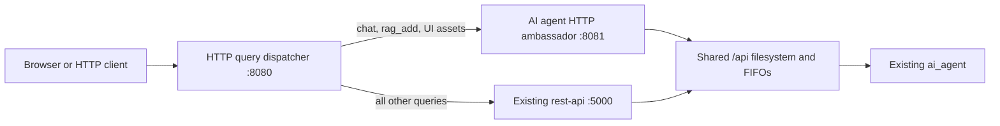

# HTTP query dispatcher

Envoy forwards selected filesystem API HTTP paths to a dedicated HTTP service.
All other requests continue to the existing, auto-generated `rest-api` service.
This component does not access the filesystem API mount.



## Configuration

`envoy.yaml` is the configuration file supplied to Envoy with `-c`. It is a native
Envoy configuration; no code generation is required. Route order matters: the
first match wins, and the final `/` prefix is the generic fallback.

| Request path | Upstream cluster |
| --- | --- |
| `/api.pmccabe_collector.restapi.org/ai_agent/chat/v1` | `ai_agent_http` |
| `/api.pmccabe_collector.restapi.org/ai_agent/rag/add_doc/v1` | `ai_agent_http` |
| `/ai-agent-ui/…` | `ai_agent_http` |
| Everything else | `generic_rest_api` |

The first two routes match an optional trailing slash. Query strings do not
affect matching. Paths, request methods, bodies, and query strings are forwarded
unchanged. Route selection applies to all methods, including the GET pages and
POST/PUT actions. The upstream decides which methods it supports. The dedicated
UI asset namespace leaves the generic server's `/static/` paths available.

To add another exception, insert a route before the fallback and reference an
upstream cluster. Edit each cluster's `socket_address.address` and `port_value`
to change its destination. Multiple `lb_endpoints` in one cluster enable round
robin balancing. Do not balance chat/upload between the generic and dedicated
servers: their request formats differ.

The example uses HTTP on ports 8080, 5000 and 8081. An alternative hostname for
either upstream is supported independently of its port. Envoy normalizes paths,
merges repeated slashes and rejects escaped slashes. There is no automatic retry
policy: uploads may mutate the knowledge base and must not be replayed after an
ambiguous failure. The dedicated route timeout is 910 seconds, above the server's
900-second FIFO deadline; stream inactivity allows 920 seconds. Keep these values
consistent if changing the server's timeout. The generic route timeout is 60
seconds and can be increased for slow generic queries.

## Run beside the existing services

The following commands run **only the two new components**. First start the
existing agent and `rest-api` using your usual deployment. They must already
share the external `api.pmccabe_collector.restapi.org` Docker volume, and the
servers must join the existing `api.pmccabe_collector.network` network.

From the repository root:

```sh
docker compose -f ai_agents_framework/ai_agent/ai_agent_http_embassador/compose.yaml up -d --build
docker compose -f fs_api_proxy/http_query_dispatcher/compose.yaml up -d
```

The default cluster destinations are `rest-api:5000` and
`ai-agent-http-ambassador:8081`. Ensure `rest-api` resolves to your existing
generic HTTP server, or change that address in `envoy.yaml`. These Compose files
do not create or modify the existing services. They can also be included in a
new deployment's Compose `include` list. Set `HTTP_QUERY_DISPATCHER_PORT` to
change the published entry port.

Open:

- Chat: `http://localhost:8080/api.pmccabe_collector.restapi.org/ai_agent/chat/v1`
- Upload: `http://localhost:8080/api.pmccabe_collector.restapi.org/ai_agent/rag/add_doc/v1`

Validate the configuration and restart after editing it:

```sh
docker compose -f fs_api_proxy/http_query_dispatcher/compose.yaml run --rm http-query-dispatcher envoy --mode validate -c /etc/envoy/envoy.yaml
docker compose -f fs_api_proxy/http_query_dispatcher/compose.yaml restart http-query-dispatcher
```

## Local pod, different machine, or standalone Envoy

For all services in one Kubernetes pod, use `127.0.0.1` as both upstream
addresses and retain distinct ports. Mount the same local filesystem volume
into the agent, generic server, and dedicated server. Supply `envoy.yaml` as a
ConfigMap or local configuration file.

For a dispatcher on a separate machine, change the upstream addresses to the
API machine's reachable hostname/IP. The existing generic Compose service
publishes port 5000. Publish port 8081 for the dedicated server using a new
Compose override, or expose both backends with Kubernetes Services. The provided
ambassador Compose file uses `expose`, which makes port 8081 available within its
Docker network but does not publish it on the host. Only the two HTTP servers
and the agent need the local shared filesystem; the remote dispatcher does not.

Without Docker, run `envoy -c /absolute/path/to/envoy.yaml`. Mount a replacement
configuration at `/etc/envoy/envoy.yaml` when running the image directly.

## Integration verification

See the ambassador's [test instructions](../../ai_agents_framework/ai_agent/ai_agent_http_embassador/README.md#tests).
The opt-in Envoy tests run real HTTP requests through the pinned configuration,
using the actual generated filesystem API dispatcher and lightweight replacements
for the ML programs. They check GET pages, POST chat, PUT uploads, static assets,
trailing slashes, query strings, method errors and generic forwarding.
